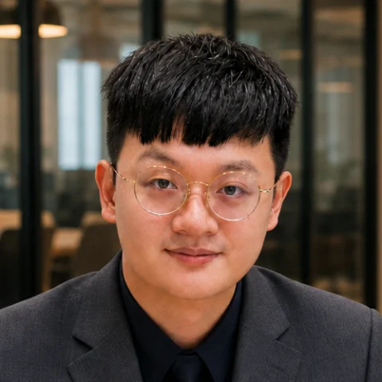

# 水球潘（Johnny）

> 自我介紹草稿，待本人確認全文與公開內容；尚未提交 PR。

## 我是誰

大家好，我是水球潘，是 AI-Native Global Founders Speedrun Taiwan 的創辦人，以總召的角色創立這個非營利組織。

我是水球軟體學院的創辦人暨講師，也是一位投入軟體工程教育的老闆兼軟體企業顧問，目前正踏上全球產品創業之路。我不是以什麼了不起的身份來組織這個社群，而是以「在其位，知其苦」的角度，找大家一起學習、交流與嘗試。

Member ID：00（本人指定編號）
GitHub：[Johnny850807](https://github.com/Johnny850807)

> 編號待對齊：上述編號依本人此次指定保存，尚未依現行六位數正整數規格完成配置；本草稿不代表正式成員或 Leader 資格已生效。

## 我為什麼創辦這個組織

我的專長，是將複雜的知識整理成大家可以上手的攻略。既然我自己也正踏上全球產品創業之路，我想趁這個機會，找其他人一起鑽研。

一個人獨享攻略？不，不如大家一起鑽研攻略，這樣既簡單又好玩。

我希望讓困在台灣的更多創業者，能一起向前輩收集知識與認知，理解出海創業有哪些選擇、upfront plan 和募資成本需要納入思考。大家不一定都要直接挑戰創業，但至少能在有限的人生中，先得到更完整的創業認知，再做出自己的選擇。

## Vision：我希望這個組織帶來什麼

用一份筆記槓桿全台創業者的認知。

我希望，想探索創業這條路的人，一開始就能有高含金量的教材可以參考，照著 SOP 思考、逐步突破，慢慢培養出海創業的能力。無論什麼背景，都能進來吸收認知、認識彼此，找到願意一起嘗試的夥伴。

我們可以一起請益創業前輩，把見解整理成系統化的教育資源，讓前輩投入的時間幫助更多人。我也希望大家一起取得國際資源、帶回台灣，讓自己從中受益，也讓台灣社會受益。

這個組織是公益性質的非營利組織；開源筆記沒有商業目的，會保留資訊貢獻者的署名。大家都是志工，可以按照自己的方式回饋，不要求一定要幫忙。

## 想要獲得什麼

我想認識有 AI-Native 產品新創募資經驗，或正在這條路上的夥伴，一起 Coffee Chat 或線上交換知識。我自己也需要吸收大家的認知，把 Funding Plan 的成本計算清楚，讓自己和團隊理解全球產品創業之路該怎麼進行。

## 想分享什麼

我想分享將複雜知識整理成攻略的做法，以及自己在全球產品創業之路上持續學到的東西。我希望把大家的經驗與見解整理成開源筆記，保留資訊貢獻者的署名，讓後來的人可以直接參考，而不必每個人重新做一大堆相似的 Coffee Chat。

## 我的 Contributions：可以幫什麼忙、想要幫什麼忙

### 可以幫什麼忙

我可以協助將複雜的知識整理成容易上手的攻略，把創業前輩的見解整理成系統化的教育資源，讓不同背景的人能夠理解並參考。

### 想要幫什麼忙

我想和大家一起請益創業前輩，整理產品創業、出海、募資的經驗，累積不同 Founder-Market Fit、Founding Team 與產業的攻略和流派。我也想持續維護開源筆記，讓資訊貢獻者投入的時間可以幫助更多創業者。

這些是我可以協助及想參與的方向，不代表已接受任何指定工作。

## 提交前待本人確認

- 會員編號與現行識別規格的差異尚待處理。
- 尚未選定本次 Contributors assignment，不從上述 Contributions 自動推定。
- 尚待本人確認對現行憲法與基本參與度義務的理解與接受，以及全文、照片與公開內容。

## 內容依據

本草稿依本人既有的[創辦人的話](../specs/00-願景和問題/創辦人的話.md)與[發起組織時的原話](../plans/001-Kickoff/歷史紀錄.md)整理；保留原檔，不代改創辦人原文。
