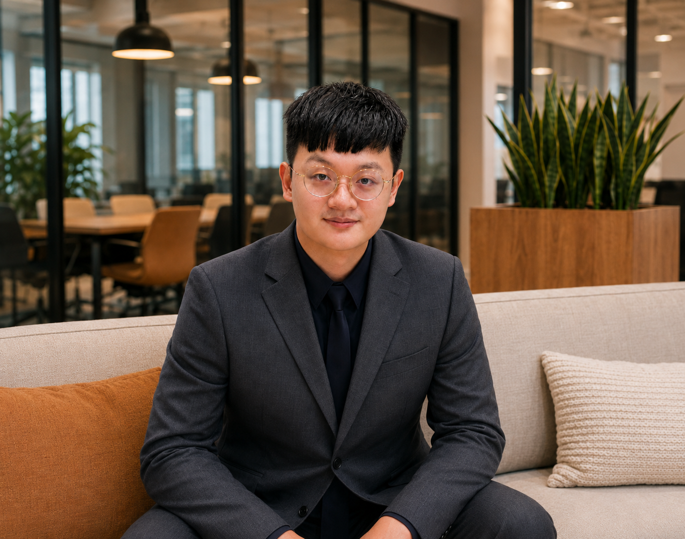
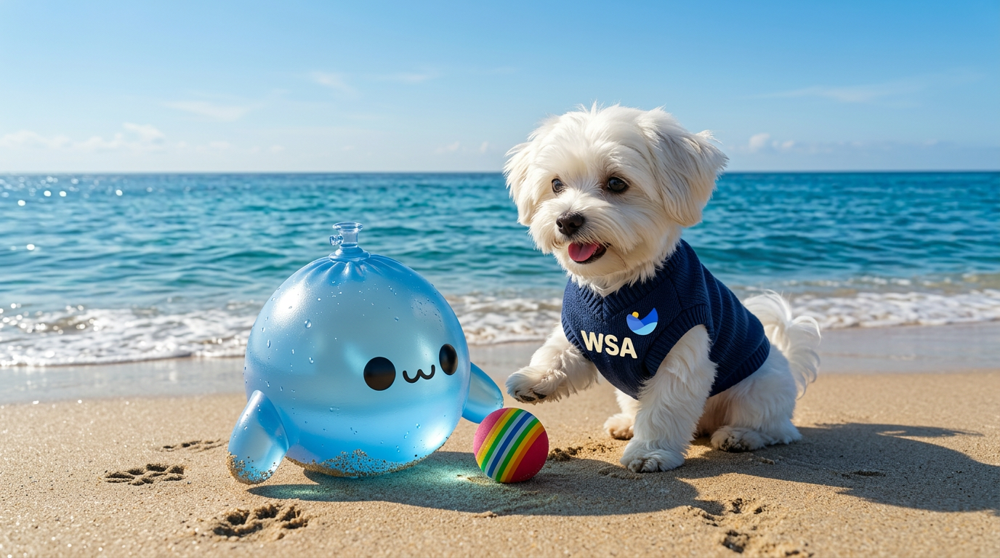
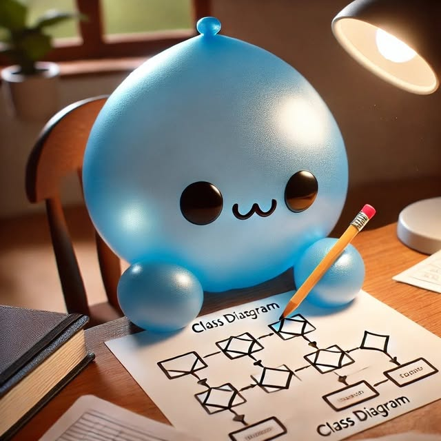

# 水球潘（Johnny Pan）

## 成員資料

Member ID：000000
GitHub：[Johnny850807](https://github.com/Johnny850807)

## 我是誰

大家好，我是水球潘，是 AI-Native Global Founders Speedrun Taiwan 的創辦人，以總召的角色創立這個非營利組織。

我是水球軟體學院的創辦人暨講師，也是一位投入軟體工程教育的老闆兼軟體企業顧問，目前正踏上全球產品創業之路。我不是以什麼了不起的身份來組織這個社群，而是以「在其位，知其苦」的角度，找大家一起學習、交流與嘗試。

## 我正在 build 的產品或專案

我目前正在 build 的產品是 [AllWill](https://allwill.ai/)，一個讓人與 AI agents 一起規劃、持續同步知識的協作工具。我想解決的問題是：每個人用了 AI 之後都變快了，但團隊仍可能各自依照不同的理解做事。一個部門的修改，可能影響另一個部門；文件雖然更新了，大家卻不一定知道哪些內容已經取得共識。

AllWill 讓一項變更涉及的人與他們的 AI agents 在同一份 plan 中協作，由實際負責的人確認並採納。變更採納後，再同步到依賴它的 plans、specs 與知識，保留其他人尚未完成的修改，並指出不再一致的地方。每次同意都對應當時確認的版本；內容改變時，再重新確認，讓接手的人與 AI 能從團隊已同意的內容繼續工作。

## 在網路上，我常常會化身為水球小生物

其實我本身並不喜歡曬形象照，那是為了讓客戶別瞧不起自己，所以才放形象照的，算是迫於世道所逼 XDD

但我更喜歡當一顆可愛的小水球生物，也沒啥特別原因，因為我認為活著只要可愛又努力就行了。

## Vision：我希望這個組織帶來什麼

請見[組織 Vision](../specs/00-願景和問題/vision.md)。

## 我的 Contributions：可以幫什麼忙、想要幫什麼忙

### 可以+想要幫什麼忙

1. 我是老師，創立了[水球軟體學院](https://waterballsa.tw)。我非常擅長將極其複雜的知識，整理成容易上手的系統化攻略以及 SOP。
2. 由於本身也在創業中，希望能夠出海，在美國或矽谷有良好的發展，因此我非常樂意以自己作為組織的核心齒輪，帶動大家一起從中受益。我可以幫忙媒合 VC、出海發展成功的前輩與投資人，以及矽谷當地和台灣可使用的資源與 network。
3. 我對去中心化組織的設計、憲政體制的運作、誘因設計等也都有一些研究，因此願意投入心力在此，幫助組織變得更好。
4. 經營軟體工程社群有一些成績：在一年內吸引了 6,000 多人加入水球軟體學院社群；當時每週舉辦活動，平均觀眾人數約 73 人，一年舉辦了 140 多場活動。自己對於經營線上聚會與社群有一些不錯的想法和技巧，這方面也可以幫忙。
5. 我目前擔任台灣軟體企業或非軟體企業導入 AI 的顧問，範疇涵蓋軟工方法，以及行銷、幕僚單位的營運自動化與效率提升方法。在這方面，我自己有一些知識可以引入。

   這也是為什麼我在經營「AI-Native Global Founders Speedrun」的 monorepo 時，是使用 plan、specs 的方式來經營。某種程度上它取得了一些成功，並累積了導入 shared context、透過 GitHub repository 做 knowledge management 的經驗。

   所以在這個公益組織中，如果有人想要交流這方面的想法，我都非常樂意，一起來追求更好、更具蜂巢智慧的組織經營方式。

## 網域贊助與部署

目前 aifounders.tw 這個網域是由我所經營的公司「水球球特務有限公司」所贊助的，部署在我們自己家的雲端上。

相關分工：[基建-Domain-Name 維護](r-and-r-assignment.md#domain-name)。
