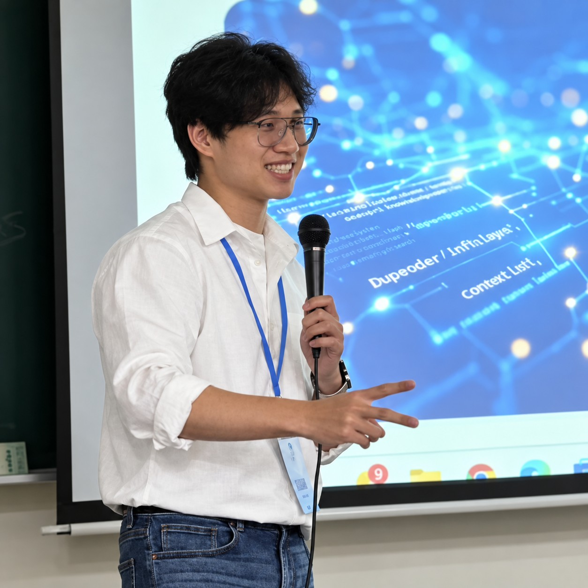

# 品毅

## 我是誰

我目前負責水球球特務有限公司 B2B 事業體的建立與成長，並擔任多間企業的企業顧問與內訓講師。

Member ID：000005
GitHub：ping-yee

## 為什麼想加入

雖然目前沒有出海或創業的計畫，我仍希望在這裡學習創業經驗、認識不同的創業家，與大家交流資源及經驗，在互惠互利中共同成長。

## 想要獲得什麼

我希望了解其他企業與團隊如何走向規模化，這是我目前尚未實作、想進一步學習的部分。

我也希望以觀察者的角度，看見這個組織建立與成長的歷程，理解團隊如何運作，並認識參與其中的夥伴。

## 想分享什麼

我願意分享企業 AI 開發導入與教育的實務經驗，包含 Vibe Coding 的交付速度與可靠度。目前已有幾間企業在上完課、將課程做法導入團隊後，研發團隊的開發產出提升至少三倍。

我也願意分享事業體早期成長與產品形成的經驗：從聽取客戶需求、思考問題與解法是否契合、打造並驗證產品，到依客戶回饋進行回顧與產品調整，涵蓋客戶洽談及最後交付。

## 我的貢獻：可以幫什麼忙、想要幫什麼忙

### 可以幫什麼忙

我可以協助管理與維護組織的儲存庫。

### 想要幫什麼忙

我希望參與「基建-Repository 維護」分工，協助團隊運作。我本身從事 AI-Native 相關工作，也想在這個組織中實驗這些技術的實際成效。

## 參與原則

我願意遵守組織憲法，保有交流、學習與協作的參與意願。具體工作依自己的意願認領，接受後會履行責任；若無法繼續，會說明並交接。
