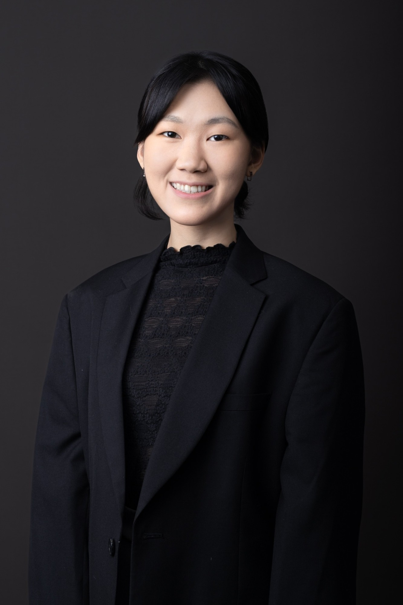

# Jasmine Ow

## 我是誰

我是 Jasmine，SonicStride 的 Founder，在台北。

SonicStride 是一個 iPhone + Apple Watch App：用手錶讀取心率、步頻等身體訊號，讓音樂即時跟著身體變化，每次跑步都變成一張屬於自己的專輯。另一條產品線是 SonicStride Studio，一個互動音樂編輯器，已經在實際的瑜伽課、翻滾課上使用過。目前還在早期，App 正在 TestFlight Beta 測試，產品體驗與市場都還在驗證中。

我也在台北主辦 LFR（Founder Run Club），一個每週固定的創辦人跑團：跑 30 分鐘、一起吃早餐或晚餐、一起 cowork。

我關注身體、動作與音樂之間的關係，以及互動音樂與 AI 音樂。我希望科技能把人帶回自己的身體與當下，而不是讓人更依賴螢幕。

一些背景：

- 畢業於國立成功大學工業設計系。SonicStride 源自我的大學畢業論文，2023 年 5 月創立，形式從藝術裝置、遊戲，一路演變成現在給跑者與瑜伽等真實運動場景使用的產品。
- 2023 年獲教育部 U-Start 創業計畫、成大創新創業計畫第一名。
- 在玩美移動（Perfect Corp）擔任過 YouCam AI Pro 的 Product Owner & PM，經歷涵蓋 UX/UI 設計、產品管理與社群經營。
- 我不是傳統工程背景，用 Claude Code 自己開發 iOS / Apple Watch App，也親手寫出 Studio 編輯器的第一版。
- 跳舞多年，也練 Vinyasa 瑜伽，常說自己是 designer-founder-dancer。
- 曾在 CVC × TASC Startup Networking Night、「Claude Code × Music」、Blessed. × Digital Vikings「Founder Stories」、AI Tinkerers Taipei 等場合分享或展示。

Member ID：待配置
GitHub：Jasmineow
其他聯絡方式或作品連結：

- 官網：https://www.sonicstride.app
- Instagram：https://www.instagram.com/sonicstride
- LinkedIn：https://www.linkedin.com/in/jasmine-ow-853077175
- LFR 跑團：https://lfr-sonicstride.vercel.app

## 為什麼想加入

我想加入，是因為認同這個組織共享創業與出海知識的方式，也希望自己能成為其中的一份子，一起貢獻。

這也和我自己的處境有關：我長期一個人推進 SonicStride，盡量自己做，也一直在找對的夥伴，不想再一個人做。我的目標市場是以美國為主的英語市場，但線下活動只能先從台灣開始。現在最大的兩個缺口，是把產品交到對的人手上，以及讓產品達到自己的體驗標準。這些都是我想和同樣在路上的人一起交流、互相補上的地方；我也想把自己踩過的坑整理出來，分享給後面的人。

## 想要獲得什麼

- 找到能互補的長期夥伴。
- 釐清怎麼讓產品被對的人用到，並讓人自己回來繼續用。
- 了解往英語市場（美國）發展需要知道的事。
- 練好英文演講。
- 認識音樂創作者、AI 音樂研究者，以及願意一起設計量測方法的實驗室或研究者。
- 了解適合女性創辦人的加速器與創業計畫。

## 想分享什麼

- 不是傳統工程背景，把 Claude Code 當成團隊成員，自己做出 iOS / Apple Watch App 和互動音樂編輯器的過程。
- 用真人課堂當測試場：在瑜伽、翻滾課上驗證產品，比讓人自己下載 App 更快拿到真實反應；有人陪著用和自己摸索的落差很大。
- TestFlight 公測踩過的坑：公開連結發出去收不到回饋，後來改成先篩裝置再邀請。
- 管理系統踩過的坑：三年用過七個系統，都死於只記計畫、不寫回結果、靠意志力維護。
- 辦活動的流程：先定活動目的與 KPI，再規劃素材與平台，再交給設計；用 Luma 報名、IG 宣傳。
- 經營創辦人跑團的設計：只比堅持、不比速度，刻意不走 networking 導向。
- 產品定位與對外文案的練習，例如從「身體訊號」講到「每次跑步都變成一張專輯」。

## 我的 Contributions：可以幫什麼忙、想要幫什麼忙

### 可以幫什麼忙

- **活動籌辦：** 用 Luma 辦活動、設計報名流程；實際辦過收費體驗課與每週跑團。
- **IG 內容：** 活動貼文與輪播，做過輪播模板與中英文案語氣規範。
- **產品定位與規格討論：** PM 背景，擅長把系統框架寫成別人能執行的規格。
- **UX/UI 與視覺設計：** 工業設計與 UX/UI 背景，做過品牌色系與演講 deck。
- **小型網站與基建：** 用 Claude Code 建小型網站，管理 Vercel、Cloudflare DNS 與 GitHub；有實際操作經驗，但不是專業工程師等級。
- **中英雙語：** 翻譯與撰寫。

### 想要幫什麼忙

我最想投入的是社群經營與媒體宣傳：

- **社群：** 一起建立一群會持續出現、互相支持的創辦人社群；也想協助籌辦組織的交流活動，例如分享會或實體聚會，可以從報名流程與活動宣傳開始幫忙。
- **媒體宣傳：** 想協助組織在 IG、Threads 等自媒體上的宣傳與內容，讓更多創業者知道這裡在做什麼。這也是我想持續練習的方向：經營對外的聲音，包括英文的公開表達。
- **知識整理：** 想把自己做產品、辦活動、用 AI 開發時踩過的坑，整理成開源筆記，分享給其他創業者。

## 我對參與方式的理解

我理解這裡的參與是自願的，也會遵守組織的憲法與制度。我會保持參與意願，依自己的時間交流、學習與協作；認領的工作會負責完成，做不下去時會說明並交接。分享 SonicStride 的經驗時，我會以交流為目的，不用組織名義推銷產品。
