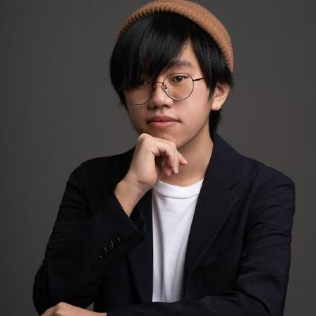

# Ray 貓（吳睿誠）

## 我是誰

我是 Ray 貓，AI 一人公司創業者、全端工程師，也是技術書作者。現在一個人做產品、課程和內容，從需求、開發到營運都自己來，大量用 AI Agent 把工作流程自動化。著有《從零開始，打造一個生成式 AI 平台》，曾在 TEDxNCU、COSCUP、JSDC 分享 AI 產品與工程實戰。

Member ID：待配置
GitHub：SR0725
其他聯絡方式或作品連結：[官方網站](https://www.ray-realms.com/)、[部落格](https://blog.ray-realms.com/)

## 為什麼想加入

我打算直接往國外衝，希望在這個過程中建立影響力，所以想在這個組織初期就直接下場，一起把事情做起來。

## 想要獲得什麼

影響力與人脈資源。

## 想分享什麼

- 開美國公司的經驗。
- 我自己的創業經驗。
- To C 產品的 distribution 經驗。

## 我的 Contributions：可以幫什麼忙、想要幫什麼忙

### 可以幫什麼忙

- **網站與系統開發**：前後端開發、網站 UI/UX 調整與維護，從需求到上線都能接。

### 想要幫什麼忙

- **Hacker**：想參與組織網站與相關系統的設計、開發與維護。我願意擔任 Hacker 的 Leader，實際任命依憲政制度辦理。

## 對基本義務的理解

我理解並接受以下義務：

- 遵守[憲法](../specs/01-制度/憲法.md)與現行制度，包括不以組織名義推銷特定公司、不收費置入或推薦，整理知識時保留貢獻者署名。
- 保有參與意願；長期沒有可確認的參與時，依制度回覆是否保留資格。
- 履行自己接受的職責；無法繼續時主動揭露並交接。
