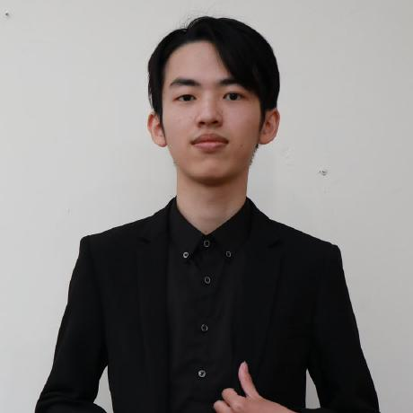

# Sun（謝上智）

## 成員資料

Member ID：待配置

GitHub：SunZhi-Will

## 我是誰

大家好，我是 Sun，來自台灣，目前是軟體工程師，也是獨立開發者。平常主要接觸軟體開發、AI 應用、AI Agent 與各種開發工具，也喜歡把學到的技術整理成文章、課程或實際產品。

除了本業的軟體開發工作，我目前也在做這幾件事：

- **獨立產品開發：** 開發自己的網站、工具與 SaaS 產品，持續探索產品化與商業模式。
- **獨立遊戲開發：** 一個人製作《方界：破碎祭壇》（Fangjie: Shattered Altars），已在 Steam 推出試玩版。
- **AI 應用實踐：** 研究 AI Agent、Claude Code、Vibe Coding，以及如何運用 AI 降低開發與營運成本。
- **社群經營：** 經營「極端工程師 Sun 分享交流群」，也協助管理 Useful Indie Hacker 產品設計開發社群。
- **技術分享與教學：** 曾參與學校、企業的技術課程與工作坊，分享 AI 與軟體開發相關經驗。

我比較喜歡從實作出發，先把東西做出來，再透過使用者回饋不斷修正。

## 為什麼想加入

我一直對「一個人或小團隊，能不能借助 AI 做出真正有價值的產品」這件事很感興趣。

過去我比較專注在技術與產品實作，但逐漸發現，產品做得出來只是第一步，後續還有市場驗證、使用者成長、商業模式與國際市場等問題。這些也是我目前正在學習和探索的方向。

看到這個組織希望透過開源知識，減少創業者反覆摸索與資訊不對稱的成本，我很認同這個理念；尤其是把創業經驗整理成可以持續累積、讓後來的人也能使用的知識，而不是只留在少數人的交流中。

## 想要獲得什麼

- 認識不同背景的創業者、獨立開發者與產品經營者。
- 了解台灣團隊進入國際市場的實際經驗與挑戰。
- 學習市場驗證、商業模式、產品成長與出海策略。
- 觀察 AI-Native 組織如何真正運作，而不只是使用 AI 工具。
- 找到能互相交流、合作及分享實戰經驗的夥伴。

## 想分享什麼

我希望分享自己實際做過、踩過坑的經驗：

- AI Coding 與 AI Agent 在真實專案中的應用。
- 個人開發者如何利用 AI 完成產品原型與 MVP。
- 網站、SaaS、遊戲等不同產品的開發與部署經驗。
- 獨立開發過程中的技術選擇、成本與限制。
- 技術社群經營、內容分享與工作坊的實務心得。

不一定每件事情都有標準答案，但希望能把實際做過的事情和遇到的問題分享出來，讓其他人少走一些彎路。

## 我的 Contributions：可以幫什麼忙、想要幫什麼忙

### 可以幫什麼忙

- **技術開發：** 熟悉 TypeScript、React、Python、C#、雲端部署及 AI API 整合，能依實際需求參與網站、開源工具、AI 自動化或內部系統的開發與改善。
- **知識整理：** 協助將創業者訪談、技術實踐或實際案例，整理成容易閱讀、可搜尋、可持續維護的開源文件。
- **社群分享與活動支援：** 可以協助技術主題分享、工作坊規劃、活動宣傳，以及與開發者社群交流。

### 想要幫什麼忙

- **Hacker／技術開發（主要意願）：** 優先參與網站、開源工具、AI 自動化或內部系統的工作。
- **知識與流派整理：** 也希望探索如何運用 AI 降低知識整理與維護成本。
- **活動籌辦與協助：** 想協助技術主題分享、工作坊規劃與活動宣傳。若依制度獲任命，也願意承擔這項 R&R 的 Leader。

目前有自己的工作與獨立開發專案，參與時間需要彈性安排。承接具體任務時，我會先確認範圍與可投入時間，並對已承諾的事情負責。

## 基本義務

我願意遵守憲法與現行制度，不以組織的名義、知識內容或活動推銷特定公司的產品或服務。我會保有參與意願，以交流、學習、協作或回覆持續參與；接受具體工作後會履行，無法繼續時主動揭露並交接。

我創立 Synvize，並另經營付費課程、收費聚會、軟體接案與企業工作坊，與本組織無關，不在組織內推廣；若涉及相關案件，會依憲法揭露並迴避。

很高興有機會認識大家。希望除了學習其他創業者的經驗，也能把自己在技術、產品與 AI 應用上的實踐分享出來，一起讓好的經驗不只留在一次聊天裡，而是能持續幫助更多人。
