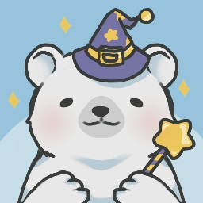

# Yapi（吳子楊）

## 我是誰

馬來西亞人，住在宜蘭。Unity 開發十年以上，第一款 Steam 遊戲賣出兩萬套以上。目前在東吳大學教 AI 遊戲開發，在博客來出版 Vibe Unity，經營 YouTube 頻道與 Yapi Flow 社群（LINE／Discord）。

一人公司 Larch（larch.ink）創辦人，經營約兩年，是結合直播問答、聊天、作業、商城與付費解鎖的互動教學平台；另有 Yayapipi Studio。也在開發遊戲引擎與 AI 工具：Simtuit、Simbrush、Simdraft、Akarion／Muse Link。

日常以 AI-Native 方式經營公司：用一組 AI agent 分擔 PM、CMO、CFO、CTO、客服等角色，開發主要靠 Claude Code 與 Codex。11/12 會參加 YC Startup School Taipei。

Member ID：待配置
GitHub：yayapipi
其他聯絡方式或作品連結：https://larch.ink、GitHub yayapipi

## 為什麼想加入

一人公司做到現在，產品與內容在台灣能跑，但要出海、規模化或融資時，缺少前人的路徑與可比較的選擇。這個組織把創業與出海經驗整理成開源知識，正好補上這塊，也想把自己 AI-Native 一人公司的做法放進來讓大家驗證、比較。

## 想要獲得什麼

- 出海路徑：教育與工具類產品如何打國際市場、定價與金流、法人設立的選擇。
- 融資與 YC 等加速器的實際經驗，一人公司是否適合、何時該擴編。
- 認識同樣用 AI agent 經營公司、做遊戲或創作者工具的創業者。

## 想分享什麼

- 一人公司加 AI agent 團隊的實際分工、工作流與踩過的坑。
- 用 Claude Code／Codex 做產品與遊戲開發的 vibe coding 流程。
- 獨立遊戲上 Steam、教學平台變現、社群經營與 YouTube 內容成長的經驗。
- 與海外 AI 公司做業配與聯盟合作的經驗。

## 我的 Contributions：可以幫什麼忙、想要幫什麼忙

### 可以幫什麼忙

- 整理 AI-Native 一人公司流派：寫成可重用的攻略、agent 設定與 skill 範例。
- 擔任分享講者：AI 遊戲開發、vibe coding、一人公司營運主題，線上或線下皆可。
- 透過 YouTube、Threads、Yapi Flow 社群協助宣傳組織活動與招募。
- 小型工具或網站的技術協助（Unity、AI 工具串接、自動化流程）。

### 想要幫什麼忙

- 參與開源創業知識及流派整理，從 AI-Native 一人公司與 Gamification 方向開始嘗試。
- 協助籌辦以 AI 工具實作為主的工作坊或分享會。
